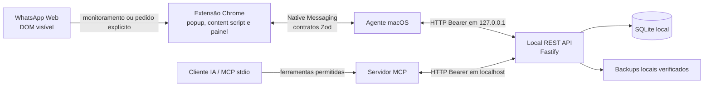

# WAI Bridge

WAI Bridge é uma integração local entre a interface visível do WhatsApp Web, uma extensão Chrome, um agente macOS Native Messaging, uma API REST em `localhost`, SQLite e ferramentas MCP. A extensão observa somente o conteúdo renderizado que está autorizado e disponível na interface. A API valida contratos, aplica regras de negócio e persiste o estado local. Clientes MCP chamam a API; não leem diretamente o banco.

O projeto é software experimental para desenvolvimento e homologação local. A cobertura da interface é parcial e depende da estrutura atual do WhatsApp Web. Não é um serviço hospedado, não deve ser exposto à internet e não tem compatibilidade oficial garantida com o WhatsApp. O runtime de envio mantém gates explícitos; o executor da API é simulado e a autorização AUTO é negada por padrão.

## Como os componentes interagem



O popup controla o monitoramento e os opt-ins da extensão. O content script trabalha sobre a UI visível e não acessa arquivos de sessão, protocolos internos ou o SQLite. O painel operacional envia pedidos administrativos pelo service worker e pelo canal Native Messaging validado. O agente apenas transporta envelopes allowlisted; a API é a autoridade para contratos, autorização e persistência. O MCP também chama somente a API. Conteúdo vindo do WhatsApp é dado não confiável e nunca altera permissões ou instruções do sistema.

## Requisitos

- macOS para instalar o agente Native Messaging; Chrome ou Chromium para a extensão.
- Node.js `>=24 <27` e pnpm `>=11` (o workspace fixa pnpm `11.20.0`).
- Para os testes Playwright no macOS, Google Chrome em `/Applications/Google Chrome.app/Contents/MacOS/Google Chrome` conforme `apps/chrome-extension/playwright.config.ts`.
- Gitleaks para habilitar a proteção de segredos no hook Git: `brew install gitleaks`.

## Instalar dependências, compilar e testar

Na raiz do repositório:

```sh
pnpm install --frozen-lockfile
pnpm build
pnpm typecheck
pnpm lint
pnpm test
pnpm test:integration
pnpm test:extension:e2e
```

O teste geral usa dados sintéticos e SQLite temporário; não abre uma sessão do WhatsApp nem envia mensagens. Os comandos por componente são:

```sh
pnpm --filter @wai-bridge/local-api test
pnpm --filter @wai-bridge/mac-agent test
pnpm --filter @wai-bridge/mcp-server test
pnpm --filter @wai-bridge/chrome-extension test:unit
pnpm --filter @wai-bridge/chrome-extension test:e2e
pnpm --filter @wai-bridge/chrome-extension typecheck
pnpm --filter @wai-bridge/chrome-extension lint
```

`pnpm build` compila todos os pacotes e grava a extensão descompactada em `apps/chrome-extension/dist/`.

## Carregar e configurar a extensão no Chrome

1. Compile o projeto com `pnpm build`.
2. Acesse `chrome://extensions`, ative **Modo do desenvolvedor** e escolha **Carregar sem compactação**.
3. Selecione a pasta `apps/chrome-extension/dist/` dentro deste checkout. Anote o ID de 32 caracteres que o Chrome mostrar.
4. Clique no ícone WAI Bridge para abrir o popup. Confira a conexão com o agente, ligue **Start monitoring** somente quando quiser iniciar a observação e habilite o opt-in de envio apenas se compreender suas consequências.
5. O painel pode ser aberto pelo link **Abrir painel operacional** no popup ou diretamente como uma página da extensão:

   ```text
   chrome-extension://<ID_DA_EXTENSAO>/dashboard.html
   ```

   Para diagnóstico, use `chrome://extensions` → WAI Bridge → **Inspecionar visualizações**. Outras páginas úteis da extensão:

   ```text
   chrome://extensions
   chrome-extension://<ID_DA_EXTENSAO>/popup.html
   chrome-extension://<ID_DA_EXTENSAO>/options.html
   chrome-extension://<ID_DA_EXTENSAO>/dashboard.html
   ```

   Substitua `<ID_DA_EXTENSAO>` pelo identificador exibido na página `chrome://extensions`. Recarregar a extensão atualiza o service worker; abas do WhatsApp já abertas podem precisar de recarga separada para receber o content script novo. Uma recarga da página pode alterar os indicadores normais de leitura do próprio WhatsApp.

### Instalação local do agente macOS

Este fluxo cria configuração privada e registra o host Native Messaging para o ID da extensão. Rode no macOS, a partir da raiz do checkout:

```sh
export WAI_BRIDGE_EXTENSION_ID='<ID_DA_EXTENSAO>'
export WAI_BRIDGE_API_TOKEN="$(openssl rand -hex 32)"
./apps/mac-agent/scripts/install-macos.sh
```

O script prepara o host, a configuração local, diretórios de dados/logs e o LaunchAgent, sem carregá-lo. Revise os arquivos em `~/Library/Application Support/WaiBridge/`; depois ative o serviço explicitamente:

```sh
./apps/mac-agent/scripts/install-macos.sh --load
./apps/mac-agent/scripts/diagnose-macos.sh
```

Reinicie o Chrome para que descubra o Native Messaging host. A API fica vinculada a `127.0.0.1:47831` por padrão. Para atualizar, fazer backup ou remover o registro do serviço:

```sh
./apps/mac-agent/scripts/update-macos.sh
./apps/mac-agent/scripts/backup-macos.sh
./apps/mac-agent/scripts/uninstall-macos.sh
```

Restauração exige revisão e confirmação explícitas; consulte `docs/operations/recovery.md`. `uninstall-macos.sh --purge` também apaga a configuração local que contém o token. Dados SQLite não são apagados pelo uninstall padrão.

## O que há no painel operacional

Abra `chrome-extension://<ID_DA_EXTENSAO>/dashboard.html` ou o link no popup. O painel conversa com a API pelo canal Native Messaging; não contém token Bearer.

- **Operação e fila de captura:** resumo de status, fila e compatibilidade observada. Contagens e diagnósticos não provam cobertura integral do WhatsApp.
- **Contatos locais:** consulta apenas o catálogo SQLite cadastrado, com filtro por nome/apelido/relação, igualdade/prefixo/trecho e período de cadastro. Criar/editar exige confirmação; telefone cadastral não comprova identidade do destinatário.
- **Referências duplicadas:** permite revisar propostas e vincular ou dispensar explicitamente. Isso não combina históricos.
- **Política de leitura:** marca favoritos, prioridade e inclusão/exclusão dos lotes. `EXCLUDE` e `INDIVIDUAL_ONLY` impedem inclusão em lote automático selecionado quando incompatível.
- **Lotes:** consulta relatório, cancela próximos passos, retoma ou cria um novo lote somente com itens que falharam após pedido explícito. A navegação serial só começa após pedido explícito via ferramenta MCP; a lista do painel não dispara leitura.
- **Backup e manutenção:** consulta/configura backups locais verificados. Limpeza adicional de backups/logs vem desativada; exige ativação e confirmação específicas. A manutenção não apaga contatos, conversas, mensagens ou auditoria.

O popup também controla monitoramento, mostra estado local e possui um opt-in independente para comandos de envio originados pelo MCP. SUPERVISED aguarda ação manual; AUTO continua sujeito a autorização explícita, gates e evidência do runtime. Não faça testes de envio em uma conta real.

## Executar e testar a API local

Para desenvolvimento, use um diretório SQLite descartável ignorado pelo Git. Abra um terminal na raiz do projeto e mantenha-o aberto enquanto testa:

```sh
mkdir -p .local-data/dev
export WAI_BRIDGE_API_TOKEN="$(openssl rand -hex 32)"
export WAI_BRIDGE_DATA_DIR="$PWD/.local-data/dev"
export WAI_BRIDGE_DB_PATH="$PWD/.local-data/dev/wai-bridge.sqlite"
export WAI_BRIDGE_API_PORT=47831
pnpm --filter @wai-bridge/local-api dev
```

Use outro terminal na mesma sessão de ambiente para verificar disponibilidade e autenticação:

```sh
curl --fail --silent --show-error http://127.0.0.1:47831/health
curl --include http://127.0.0.1:47831/api/status
curl --fail --silent --show-error \
  -H "Authorization: Bearer $WAI_BRIDGE_API_TOKEN" \
  http://127.0.0.1:47831/api/status | jq 'keys'
curl --fail --silent --show-error \
  -H "Authorization: Bearer $WAI_BRIDGE_API_TOKEN" \
  http://127.0.0.1:47831/api/operations | jq 'keys'
curl --fail --silent --show-error \
  -H "Authorization: Bearer $WAI_BRIDGE_API_TOKEN" \
  http://127.0.0.1:47831/api/maintenance | jq 'keys'
```

`GET /health` é somente liveness e não exige autenticação. `/api/status`, `/api/operations` e `/api/maintenance` exigem Bearer token. A segunda chamada acima não envia token de propósito: deve retornar `401`. Evite imprimir ou copiar o corpo integral de rotas que podem conter nome, telefone, metadados de conversa ou mensagem.

O valor do token deve ter ao menos 32 caracteres. API e MCP leem as configurações do ambiente; não existe arquivo `.env` automaticamente carregado. Use `WAI_BRIDGE_API_TOKEN`, `WAI_BRIDGE_DATA_DIR`, `WAI_BRIDGE_DB_PATH` e `WAI_BRIDGE_API_PORT` para isolar a instância. Não aponte testes para o banco pessoal em `~/Library/Application Support/WaiBridge/`.

### Principais rotas

Todas as rotas abaixo, exceto `GET /health`, usam `Authorization: Bearer <token>` e prefixo `/api`.

| Rota                                                                        | Uso                                                                                           |
| --------------------------------------------------------------------------- | --------------------------------------------------------------------------------------------- |
| `GET /health`                                                               | Liveness da API local.                                                                        |
| `GET /api/status`                                                           | Estado resumido da extensão/ponte.                                                            |
| `GET /api/operations`                                                       | Resumo operacional, fila e contagens.                                                         |
| `GET /api/maintenance`                                                      | Política de backup/limpeza configurada.                                                       |
| `POST /api/maintenance/backup`                                              | Solicita backup local validado.                                                               |
| `GET /api/contacts/directory`                                               | Consulta paginada do catálogo local de contatos.                                              |
| `GET /api/conversation-reviews`                                             | Lista pendências de revisão/leitura observadas localmente.                                    |
| `POST /api/dialogue-sync`                                                   | Solicita reconciliação explícita de uma conversa; abrir a UI pode marcar leitura no WhatsApp. |
| `GET /api/dialogue-sync/:id`                                                | Consulta o resultado persistido do pedido.                                                    |
| `GET /api/dialogue-sync/:id/messages`                                       | Consulta mensagens do snapshot solicitado.                                                    |
| `POST /api/dialogue-sync-batches`                                           | Cria lote serial a partir de uma lista explícita autorizada.                                  |
| `GET /api/dialogue-sync-batches/:id`                                        | Consulta o progresso de um lote.                                                              |
| `GET /api/dialogue-sync-batches/:id/report`                                 | Consulta itens e falhas do relatório paginado.                                                |
| `POST /api/dialogue-sync-batches/:id/cancel`                                | Cancela próximos passos do lote.                                                              |
| `POST /api/dialogue-sync-batches/:id/resume`                                | Retoma explicitamente um lote pausado.                                                        |
| `GET /api/observations/:id`                                                 | Consulta uma observação persistida por UUID.                                                  |
| `GET /api/conversations` e `GET /api/conversations/:id`                     | Consulta referências locais de conversa.                                                      |
| `GET /api/conversations/:id/messages`                                       | Consulta mensagens persistidas para uma conversa.                                             |
| `GET /api/messages/unread`, `GET /api/messages/recent`, `GET /api/messages` | Consultas paginadas de mensagens/estado local; não garantem cobertura total.                  |
| `GET /api/outbox` e `GET /api/outbox/:id`                                   | Consulta comandos locais e seus estados.                                                      |
| `GET /api/diagnostics/logs`                                                 | Eventos técnicos filtrados, sem conteúdo de mensagem por contrato.                            |

Consulte `docs/api/openapi.yaml` e `docs/api/local-api.md` para parâmetros, schemas Zod, respostas e rotas completas. Para smoke test seguro, prefira `/health` e `jq 'keys'`; listagens podem conter dados pessoais da base configurada.

## Configurar e testar o servidor MCP

Compile o workspace e mantenha a API de desenvolvimento ativa com o mesmo `WAI_BRIDGE_API_TOKEN`:

```sh
pnpm --filter @wai-bridge/mcp-server build
pnpm --filter @wai-bridge/mcp-server test
```

O servidor MCP usa stdio, chama somente API autenticada em localhost e não imprime logs no canal de protocolo. Para iniciá-lo manualmente (o cliente compatível deve herdar as variáveis):

```sh
export WAI_BRIDGE_API_TOKEN='<MESMO_TOKEN_DA_API>'
export WAI_BRIDGE_API_URL='http://127.0.0.1:47831'
export WAI_MCP_PERMISSIONS='CONTACTS_READ,CONVERSATIONS_READ,OPERATIONS_READ'
pnpm --filter @wai-bridge/mcp-server dev
```

O comando fica aguardando mensagens MCP em `stdin`; não é uma API HTTP nem um prompt de shell. Configure o mesmo comando e ambiente no cliente MCP. Para executar o bundle compilado, use `node packages/mcp-server/dist/main.js`. Variáveis opcionais: `WAI_MCP_API_TIMEOUT_MS` (100–30000 ms), `WAI_MCP_ALLOW_WRITES=true` para ferramentas de escrita compatíveis e `WAI_MCP_ALLOW_EXTENSION_SENDS=true` para ferramentas de envio. Não habilite gates de escrita/envio sem necessidade; envio ainda depende de autorização literal e opt-in separado na extensão.

`WAI_MCP_PERMISSIONS` aceita capacidades enumeradas no README do pacote `packages/mcp-server/README.md`. Quando omitida, mantém compatibilidade legada; valor vazio nega ferramentas salvo consulta do perfil. Para limitar o MCP a leitura, defina explicitamente capacidades `*_READ` e não habilite os gates de escrita/envio. Após recompilar, reconecte o cliente para que descubra as ferramentas atualizadas.

## Proteção de privacidade antes de publicar

O repositório é público: não adicione nomes reais, telefones, e-mails, mensagens, screenshots de conversas, UUIDs de pedidos reais, IDs de extensão pessoal, caminhos do computador, configurações, tokens, bancos, logs, backups ou mídia. Use dados sintéticos nos testes e exemplos. `.gitignore` reduz acidentes, mas não protege arquivos já rastreados nem limpa o histórico.

Instale Gitleaks e habilite o hook local deste repositório:

```sh
brew install gitleaks
git config core.hooksPath .githooks
git config user.name "WAI Bridge Contributor"
git config user.email "wai-bridge-contributor@users.noreply.github.com"
```

O hook exige essa identidade genérica e não pessoal neste checkout; ela não vincula os commits à conta pessoal GitHub. Se quiser atribuição verificável à conta, use o endereço noreply disponibilizado nas configurações do provedor e ajuste conscientemente a regra local antes de commitar.

Antes de criar um commit, revise os caminhos e o diff staged:

```sh
git status --short
git diff --cached --name-only
git diff --cached
gitleaks git --pre-commit --staged --redact --verbose
```

O hook bloqueia caminhos/artefatos locais conhecidos, binários de mídia/documentos/arquivos compactados e falha fechado se Gitleaks não estiver instalado. Scanners não reconhecem todos os dados pessoais; revisão humana continua obrigatória. Não use `git add -f` para contornar proteções. Se um segredo foi publicado, revogue/rotacione-o imediatamente; apagar o arquivo em commit posterior não o remove do histórico remoto. A reescrita de histórico público requer coordenação e deve ser feita separadamente.

## Documentação

- [Regras de segurança](.ai/rules/security.md) e [modelo de ameaças](docs/security/threat-model.md).
- [Arquitetura](.ai/rules/architecture.md), [regras de negócio](.ai/rules/business-rules.md) e [estado verificado](.ai/context/current-state.md).
- [Operação do painel](docs/operations/operational-console.md), [contatos e lotes](docs/operations/contacts-and-batches.md) e [API](docs/api/local-api.md).
- [Instalação macOS](docs/operations/install.md), [backup](docs/operations/backup.md), [recuperação](docs/operations/recovery.md) e [diagnóstico](docs/operations/troubleshooting.md).

Não anuncie o projeto como captura integral ou envio oficial/garantido do WhatsApp. Consulte a auditoria e as limitações registradas antes de qualquer uso fora de um ambiente de desenvolvimento controlado.
